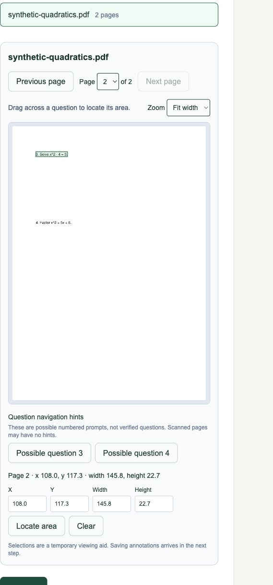

# P1-01 — Student upload and private page viewer

Status: implemented, verified and approved by the user. Phase 0 tickets approved.

## Delivered

- Student upload UI with kind-of-work confirmation, limits, SHA-256, stable retry
  keys and recent owned assessments. The server derives page count for browser
  uploads; explicit counts still must match.
- Durable private page-rendering jobs, versioned canonical PNGs, dimensions and
  rotation, including cropped/rotated/scanned sources and retained PDF annotations.
- A responsive page viewer with previous/next/page selection, fit-width/zoom,
  numbered prompt hints, drag boxes and keyboard coordinates. Coordinates refer
  to the persisted page pixels and remain aligned across resizing/zoom.
- Tentative numbered hints sort by question number, correcting the UUID tie-breaker
  that originally showed 2 before 1 and 4 before 3. They remain candidates, not
  verified extracted questions or marking claims.
- Narrow append-only worker permissions, fenced atomic evidence publication,
  generation-safe retries, inherited retention and owner-scoped images/manifests.
- Fixed streaming web proxy, bounded request bodies, no public/bearer-token image
  URLs, no-store headers, revoked image blob URLs and sign-out cleanup.
- Migration 0006, reproducible CI/Makefile viewer gate, generated synthetic review
  fixture, API/operational documentation and this acceptance report.

Review [viewer behavior](../assessments/viewer.md),
[design decision](../adr/0008-page-viewer.md),
[student interface](../../apps/web/components/assessment-workspace.tsx), and
[rendering worker](../../apps/api/app/assessments/rendering.py).

## Acceptance evidence

- API lint and strict types pass; 93 unit/SDK/domain tests pass, including six new
  native rendering/rotation/crop/scan/resource-limit/page-count/retained-mark cases.
- Web lint/types pass; 13 tests pass, including canonical-coordinate mapping and
  fixed proxy privacy/body-limit cases. The production Next.js build passes.
- Real viewer integration passes through the web proxy and actual worker. A two-page
  rotated/cropped PDF yields two PNGs and four candidate prompts in numeric order.
  Repeated preparation keeps the same job and page records; derivatives retain the
  original retention date. Parent deletion hides page access.
- Anonymous, another-student and maintainer requests cannot access student pages.
  Owned list and original bytes remain correct, with no-store responses.
- Six authentication/migration/service-boundary, three upload and four real worker/
  storage integration tests pass after introducing rendering. Migration roundtrips,
  RLS, global isolation, audit immutability and unrelated worker-read denials hold.
- Visible browser check passes: synthetic student sign-in, two-page PDF upload,
  navigation to page two, question highlighting, zoom, keyboard coordinates and
  drag selection. The synthetic assessment remains available for user review.
- All twelve long-running services are healthy and the readiness smoke check passes.

Total: 120 passing tests across API, service and web suites. Dedicated commands run
integration cases skipped in isolated unit tests. Existing test-client/vector warnings
remain non-failing. No live student data or paid inference was used.

## Scope and next step

The viewer displays canonical server-rendered PDF pages, refining the originally
proposed PDF.js approach so displayed and stored evidence coordinates share the
same pixels. It does not yet offer text search/selection. Numbered hints are a
native-text heuristic; image-only scans render without invented question locations.

Selections are temporary viewing aids. Saving/editing annotations, verified question
boundaries, evidence crops and maintainer review belong to P1-02 and later analysis
steps. No OCR, math interpretation, model call, profile inference or global learning
is introduced. Production IAM, parser containment and derivative lifecycle cleanup
remain documented staging checks.

Next: **P1-02 — maintainer annotation UI**, only after user review of P1-01.
