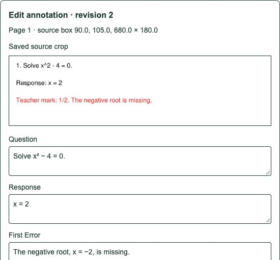

# P1-02 — Maintainer annotation studio

Status: implemented, approved by the user. P1-01 approved and pushed as 6e05b2a.

## Delivered

- Maintainer-owned source upload with explicit provenance/rights metadata, private
  page rendering/viewing and source-area selection. Student documents/accounts are
  never available to the studio and no import/promotion path was added.
- Structured question, response, marks, first error, observed behaviours with explicit
  observation status, teaching intervention and rationale. Source bounds, finite/numeric
  marks, mark totals, evidence status and intervention rationale are validated.
- Save/retrieve/edit UI with a persisted original crop, fixed source box, page,
  source SHA-256 and renderer version. Stable create IDs prevent duplicate notes/crops.
- Revision preconditions reject stale edits; append-only revision history preserves
  prior notes. Reloading saved rows leaves current form edits intact until reopened.
- Separate admin-worker page/region/manifest permissions, private crop access,
  bounded native cropping and fixed authenticated streaming proxy routes.
- Migrations 0007/0008: private structured annotations and revisions; runtime cannot
  read annotations or annotation regions even if publication flags change.
- Typed catalog, CI/Makefile integration command, safe route-template audit labels,
  synthetic marked UI fixture and operational/design documentation.

Review [studio behavior](../studio/annotations.md),
[design decision](../adr/0009-annotation-studio.md),
[maintainer interface](../../apps/web/components/annotation-studio.tsx), and
[annotation persistence](../../apps/api/app/studio/service.py).

## Acceptance evidence

- API lint/strict types and 103 unit/SDK/domain tests pass, including ten new annotation
  validation/exact-crop cases. Web lint/types and fifteen tests pass; production build passes.
- Real studio integration passes through the web proxy, maintainer API, GCS and worker:
  two-page rotated source; annotation save and unchanged retry; original PNG crop;
  edit to revision 2; old revision refuses; fields/crop retrieve correctly; history retains
  revisions 1/2; source deletion hides crop access.
- Students and anonymous users cannot read studio pages, notes or crops. Invalid source
  boxes, forged student scope and publication flags refuse. Sources/notes remain draft.
  Annotation regions remain absent from published retrieval after status flags are toggled.
- Six auth/migration/service, three upload, one student-viewer and four worker/storage
  integration tests pass. Full migration roundtrips preserve existing safeguards.
- Visible browser check passes: synthetic maintainer sign-in, source preparation,
  area selection, all structured fields, save, edit, reopen and the original crop/box.
- All twelve long-running services are healthy; readiness smoke checks pass.

Total: 133 passing tests across API/service/web suites. Integration cases skipped in
isolated unit tests run through dedicated commands. Existing test-client/vector
warnings remain non-failing. No real student data or paid inference was used.

## Scope and next step

Current annotations are human working labels, not verified mathematical findings or
approved reusable pedagogy. The studio uses only explicitly uploaded maintainer
materials. Dataset export/import/splits, consent/sanitization, verified golden labels,
model analysis and publication remain their own steps. Cloud IAM, parser containment
and full original/derivative/crop lifecycle cleanup remain staging checks.

Next: **P1-03 — versioned annotation export/import and golden dataset**, only after review.
