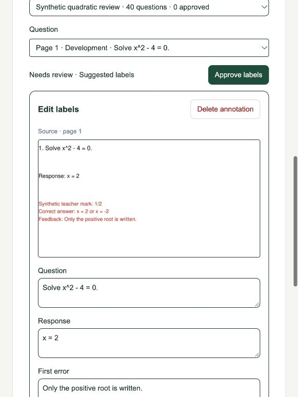

# P1-03 review changes — simpler annotation workflow

Status: implemented; awaiting user review. This addresses all five requested changes
without starting P1-04.

- Delete a PDF, page or annotation, with Undo. Removed items and their descendants
  disappear from the active studio, case review and JSONL exports.
- Upload by choosing a PDF only. Filename-derived private metadata replaces the
  title/author/publisher/permission form; publication rights are not assumed.
- Two focused tabs: PDFs & annotations, and Review labels. Compact selectors in
  narrow panes, sidebars on desktop, and collapsed collection/import/export tools.
- Revision numbers are hidden. Optimistic conflict protection and history remain
  internal. Save or discard unsaved edits before navigating or approving.
- Review and exports use the latest saved labels. Labels can be edited directly in
  review; edits invalidate old approvals. Existing saved edits are picked up without
  creating a new collection or manually adding a snapshot.

## Verification

- API lint/strict types and all 116 unit tests pass.
- Web lint/types, production build and all 17 frontend tests pass.
- Ten distinct real integration tests pass: six auth/migration/service-isolation,
  three dataset/live-review/deletion, and the existing studio regression.
- Tests verify current response/comments in review and export, approval invalidation
  and reapproval, page/annotation/PDF deletion and restoration, hidden crops/cases,
  anonymous/student denial, held-out isolation, preserved snapshots, and full
  migration upgrade/downgrade with legacy safeguards.
- Browser verification covers PDF-only upload, region selection, label saving without
  revision controls, annotation/page/PDF deletion and Undo on a disposable synthetic
  source. The user's existing held-out Page 1 comments appear in review without changing them.

**143 distinct passing tests.** Existing test-client/vector warnings remain non-failing.
No real student uploads or paid model calls are used for testing.

Deletion removes items from the active studio. Original PDFs/crops and historical
records stay private under existing retention so Undo and provenance work; page
removal preserves original page numbers. Physical purging and lifecycle expiry are
separate operational controls.

See [workflow decision](../adr/0011-studio-workflow.md),
[studio instructions](../studio/annotations.md), and
[current dataset behavior](../datasets/annotations.md).

The original 40-example proposal pack remains an initial draft reference. Live studio
labels can differ after your edits. No synthetic review labels are approved automatically.

Next: user review of these changes; P1-04 remains pending.
