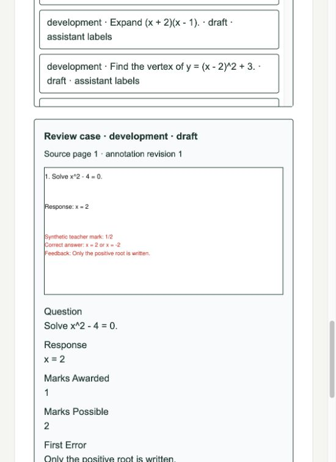

# P1-03 — Annotation datasets and JSONL transfer

Status: implementation awaiting review. **40 synthetic assistant drafts prepared;
individual human label review remains pending.** P1-02 was approved by the user.

This initial delivery report describes the original snapshot UI. The
[user-requested workflow refinement](P1-03-refinement.md) supersedes that UI: saved
edits now appear in review/export, and deletion plus PDF-only upload are available.

## Delivered

- Named dataset versions with append-only snapshots of source annotation revisions.
- Schema-v1 JSONL import/export; separate development and held-out exports, draft
  previews and explicit local label approval. Foreign approvals reset to drafts.
- Private source/crop hash verification and import replay; imports require matching
  rendered sources owned by the maintainer, with atomic database writes.
- Immutable source and normalized-question split registries; held-out sources cannot
  become development material or appear in source-bearing published runtime views.
- Required rights, deidentification, crop-review and consent attestations; identifying
  text scanner refusals; portable records omit identities, filenames and object paths.
- Maintainer UI for creating datasets, adding revision snapshots, comparing labels
  with private crops, approving cases, downloading JSONL and importing draft records.
- 40 synthetic question/response/mark/error/intervention proposals across ten
  quadratic-error families: 30 development and 10 held out, with separate source PDFs.

Review the [40-example pack](../datasets/synthetic-v1/README.md),
[JSONL and consent workflow](../datasets/annotations.md),
[design decision](../adr/0010-annotation-datasets.md) and
[dataset implementation](../../apps/api/app/datasets/service.py).

## Verification

- API lint and strict typing pass; all 116 API unit/SDK/domain tests pass.
- Web lint, type checks, production build and all 16 frontend tests pass.
- Nine real integration tests pass: six authentication/migration/service-isolation
  checks, two dataset checks and the existing annotation-studio regression.
- Dataset integration verifies pinned revision 2 survives later edits; JSONL replay
  reuses cases; imported approvals reset to drafts; missing sources and tampered crop
  hashes refuse atomically; source/question split conflicts refuse; students,
  anonymous users, peer maintainers and both worker roles cannot read datasets.
- Held-out documents, pages, ordinary regions and chunks remain absent from runtime
  retrieval even after publication flags change. Teaching demonstrations remain
  private. Snapshot updates refuse; source tombstones hide cases, crops and exports.
- Full migrations upgrade/downgrade in a disposable PostgreSQL database and preserve
  legacy data and ownership safeguards. Dataset tests rerun after adding region,
  peer-owner and worker-denial coverage and pass.
- All 40 exported draft records have distinct IDs, matching source PDF hashes and
  separate 30/10 partitions with no normalized question overlap. PDF fixtures contain
  every proposed question, response, correct answer and teacher feedback.
- Browser review verifies the 40-case list, draft labels, source page/revision, private
  crop and structured labels. The final 550px pane has no horizontal overflow.
- All twelve local services are healthy; readiness smoke checks pass. Local Docker
  stalls and PostgreSQL crash recovery delayed verification, then recovered.

**141 unique passing tests** exercised for this ticket. Existing non-failing test-client
and pgvector introspection warnings remain. No real student material or paid model
calls were used. The seeded review dataset has **zero approved labels**.

## Review checkpoint

Implementation approval and mathematical-label approval are separate. These
assistant-authored proposals remain draft until you inspect and approve each case.
The playbook's manually reviewed golden-dataset acceptance condition is still
pending. Synthetic mark allocations are proposals, not an official marking scheme.

Source and exact-question split locks catch normalized duplicates, not paraphrases
or semantic similarity. The small templated corpus does not establish OCR,
handwriting, marking or real-student generalization accuracy. Text scanning cannot
detect every identifier; manual crop/text review remains required. Private orphan
crops after failed imports require lifecycle reconciliation as in the existing
annotation pipeline.

Next: **P1-04**, only after the user reviews this implementation. Draft previews must
not be treated as verified ground truth by a future evaluation harness.
